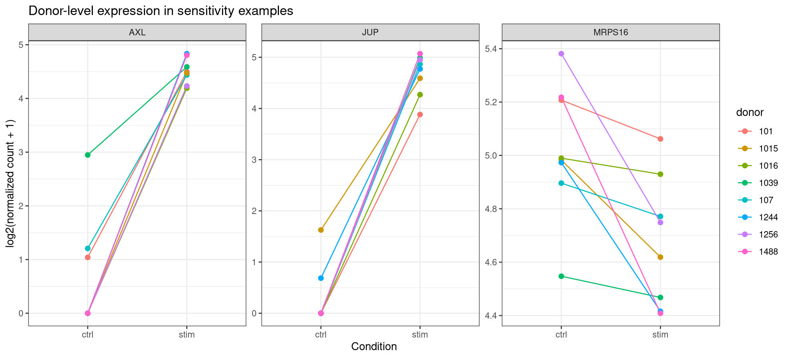
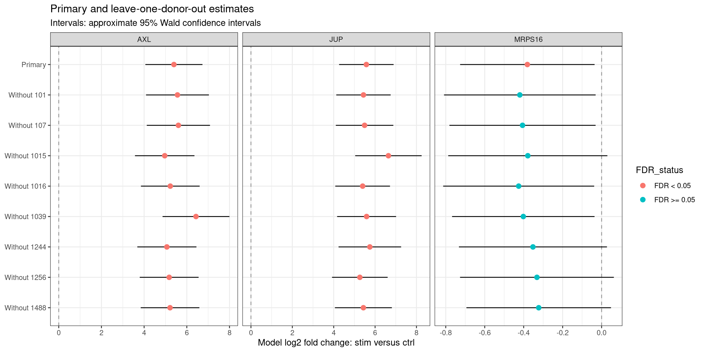

# Donor-level pseudobulk analysis and LODO sensitivity

## Research question

How does gene expression differ between IFN-beta-stimulated and
control CD14+ monocytes within the same donors?

This educational reanalysis uses the Kang18_8vs8 dataset provided
through muscData. The original study included PBMCs from eight
lupus donors, with control and IFN-beta-treated aliquots.

Source study: https://doi.org/10.1038/nbt.4042

## Biological units and cell eligibility

The independent biological units are eight donors, each contributing
one control and one stimulated profile.

The starting dataset contained 29,065 cell-associated barcodes.
Cells with a source multiplet classification other than singlet,
or a missing cell-type label, were excluded.

A total of 24,673 cells remained eligible across all cell types.
The primary expression analysis was restricted to CD14+ monocytes.

Each donor-condition profile contained 126-779 eligible CD14+
monocytes. All 16 profiles passed the planned minimum of 50 cells.

These profiles were reconstructed after donor demultiplexing.
They are not 16 independently prepared sequencing libraries.

## Pseudobulk construction and primary model

Raw counts were summed within cell type and donor-condition sample.
Control and stimulated cells from the same donor were kept separate.

The unfiltered pseudobulk matrix contained 35,635 genes and 16 samples.
Total counts were conserved during aggregation.

Genes were retained when counts were at least 10 in at least eight
of the 16 samples, yielding 3,707 genes.

DESeq2 used the paired design:

    ~ donor_id + condition

The contrast was stimulated versus control.
Positive log2 fold changes indicate higher normalized expression
in stimulated samples; negative values indicate control direction.

Benjamini-Hochberg correction was applied to the primary gene tests
within this selected cell type, with FDR < 0.05 as the reporting
threshold. Other cell types were audited for coverage but were
not included in the primary differential-expression analysis.

## Primary results

All 3,707 genes had finite p-values and available adjusted p-values.

At FDR < 0.05:
- 2,334 genes were significant.
- 1,183 had stimulated-direction effects.
- 1,151 had control-direction effects.

Exploratory PCA showed strong separation between conditions.
This visualization supports a condition-associated expression
pattern but does not independently establish its biological cause.

Normalized expression differences are relative measurements.
They do not establish absolute RNA changes per cell.

## Leave-one-donor-out sensitivity analysis

Eight additional models were fitted, each excluding both conditions
from one donor.

Each model retained seven donors, 14 samples and the primary
3,707-gene universe. Normalization and dispersion parameters were
re-estimated rather than inherited from the primary model.

Among the 2,334 primary-significant genes:
- All retained their effect direction in all eight LODO models.
- 1,977 also retained FDR < 0.05 in all eight models.
- 357 lost FDR significance in at least one model.
- One lost FDR significance in every LODO model.

Median absolute log2-fold-change differences among primary-significant
genes ranged from approximately 0.033 to 0.045 across exclusions.

Median standard-error ratios relative to the primary model ranged
from approximately 1.07 to 1.17.

Excluding donor 1015 produced the lowest retention of primary
FDR-significant genes and the largest median standard-error ratio.
Excluding donor 1016 produced the largest median absolute effect change.

These summaries measure different aspects of sensitivity.
They do not identify one donor as universally driving every result.

## Illustrative gene-level findings

### JUP and AXL: magnitude sensitivity with retained significance

JUP had a primary log2 fold change of 5.578.
LODO estimates ranged from 5.263 to 6.644, with the largest change
after excluding donor 1015.

AXL had a primary log2 fold change of 5.396.
LODO estimates ranged from 4.965 to 6.430, with the largest change
after excluding donor 1039.

Both genes retained positive direction and FDR < 0.05 in every
LODO model. Their significance was retained while their estimated
effect magnitudes showed donor sensitivity.

### MRPS16: direction retained, FDR status sensitive

MRPS16 was significant in the primary analysis but did not retain
FDR < 0.05 in any LODO model. Its estimated effect remained negative
throughout.

This illustrates that losing significance does not establish
absence of an effect or reversal of its direction.

### Previously inspected genes

CCL8, ISG20 and IRF7 retained stimulated-direction effects.
RPL6 retained a control-direction effect.

All four retained FDR < 0.05 in every LODO model.
These genes were selected after inspecting results and therefore
provide illustrative evidence rather than independent validation.

## Interpretation limits

### Condition and technical processing

The source study pooled the eight donors separately by condition
before loading the control and stimulated pools onto the 10x
Chromium instrument.

Condition therefore coincides with pool-specific processing.
The donor-blocked model accounts for donor differences but cannot
separately estimate a technical effect perfectly aligned with condition.

LODO retains this processing structure and does not resolve this
limitation. The results are described as IFN-beta-treatment-associated
expression differences, with potential technical contributions.

### Aggregation and cell-level heterogeneity

Pseudobulk assesses differences between aggregated sample profiles.
A change can arise from widespread expression changes or from
changes concentrated in a subset of the annotated cells.

It does not establish that every CD14+ monocyte responds identically.
Source annotation uncertainty and within-type composition may
contribute to the observed differences.

Cell-level mixed models can account for within-donor dependence.
Depending on their outcome, link function and weighting, they may
target a different expression feature from the pseudobulk model.

No mixed-model analysis was performed in this project.

### Sensitivity and uncertainty

LODO is an internal sensitivity analysis, not independent validation.
Its models overlap substantially and are not independent replicates.

LODO minimum and maximum effects are sensitivity ranges, not
confidence intervals.

The plotted approximate 95% Wald intervals are calculated as
log2 fold change plus or minus 1.96 standard errors. They are not
adjusted for multiple testing; excluding zero does not necessarily
imply BH-adjusted FDR < 0.05.

The FDR-retention threshold is only one summary. Effect direction,
magnitude and uncertainty must also inform interpretation.

### Scope

The analysis concerns expression within annotated CD14+ monocytes.
It does not test changes in cell-type abundance, compare lupus
with healthy donors, or establish a disease-specific mechanism.

## Figures

## Main conclusion

The primary-significant genes retained their estimated effect
directions across all donor exclusions, and most also retained
FDR significance.

Gene-level examples show that direction, effect magnitude and
statistical significance can have different sensitivity patterns.

These findings support a donor-consistent condition-associated
pattern within this dataset, subject to shared technical processing,
normalization assumptions and annotation limitations.

## Descriptive paired-direction check

Normalized pseudobulk counts were compared within each donor for
four previously selected genes.

CCL8, ISG20 and IRF7 were higher in stimulated samples in all eight
donor pairs. RPL6 was higher in control samples in all eight pairs.
No equal-count pairs were observed.

These descriptive comparisons agree with the primary model directions.
All four genes also retained direction and FDR significance in every
LODO model.

The genes were selected after inspecting the primary results.
This check is illustrative, does not constitute an additional
statistical test, and is not independent validation.
